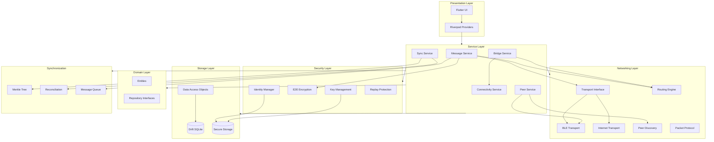
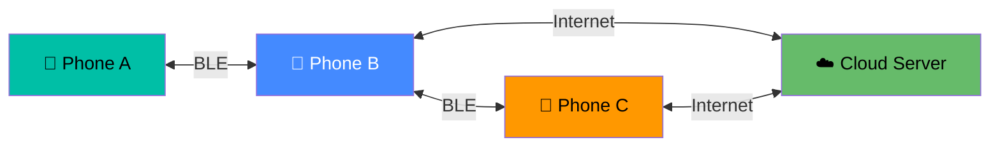

# LONE LINK — Architecture Overview

## System Architecture

## Communication Paths

### Path Types

| Path | Example | Description |
|------|---------|-------------|
| Direct BLE | A ↔ B | Two nearby phones communicate directly |
| Multi-hop BLE | A → B → C | Message relayed through intermediate node |
| Internet | A → Cloud → C | Both phones have Internet |
| Bridge | A → BLE → B → Internet → Cloud → C | B bridges BLE to Internet |
| Store-and-forward | A → Queue → ... → C | C offline, message queued |

## Layer Responsibilities

### Presentation
- Flutter widgets and screens
- Riverpod state management
- Navigation (go_router)
- No business logic

### Services
- Orchestrate domain operations
- Coordinate between networking and storage
- Manage message lifecycle
- Bridge selection logic

### Domain
- Pure business entities
- Repository interfaces (contracts)
- No framework dependencies
- Immutable data models

### Networking
- Transport abstraction (BLE / Internet interchangeable)
- BLE GATT server and client
- Packet framing and fragmentation
- Routing engine
- Peer discovery

### Security
- Cryptographic identity (Ed25519 + X25519)
- End-to-end encryption (AES-256-GCM)
- Message signatures
- Replay protection
- Secure key storage

### Storage
- Drift SQLite database
- 10 normalized tables
- Real-time streams
- Schema migrations
- Offline-first persistence

### Synchronization
- Merkle-tree message inventory
- Missing message detection
- Incremental transfer
- Deduplication during sync

## Implementation Status

| Component | Status |
|-----------|--------|
| Project architecture | ✅ IMPLEMENTED |
| Domain entities | ✅ IMPLEMENTED |
| Database schema | ✅ IMPLEMENTED |
| Repository interfaces | ✅ IMPLEMENTED |
| Transport interface | ✅ IMPLEMENTED |
| Theme system | ✅ IMPLEMENTED |
| Navigation | ✅ IMPLEMENTED |
| UI shell (all screens) | ✅ IMPLEMENTED |
| Unit tests (entities, Result) | ✅ IMPLEMENTED |
| BLE transport | ⬜ DESIGNED (Phase 2) |
| Direct BLE messaging | ⬜ DESIGNED (Phase 2) |
| Message queue | ⬜ DESIGNED (Phase 3) |
| Multi-hop routing | ⬜ DESIGNED (Phase 4) |
| Internet transport | ⬜ DESIGNED (Phase 5) |
| Bridge selection | ⬜ DESIGNED (Phase 6) |
| Merkle sync | ⬜ DESIGNED (Phase 7) |
| Encryption | ⬜ DESIGNED (Phase 8) |
