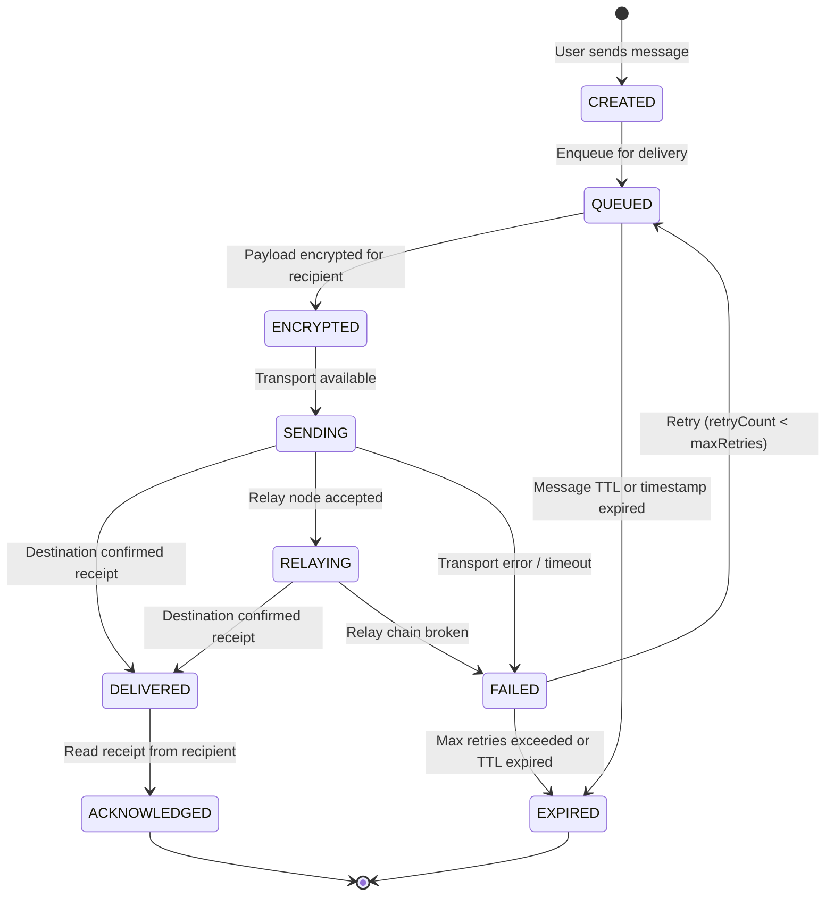
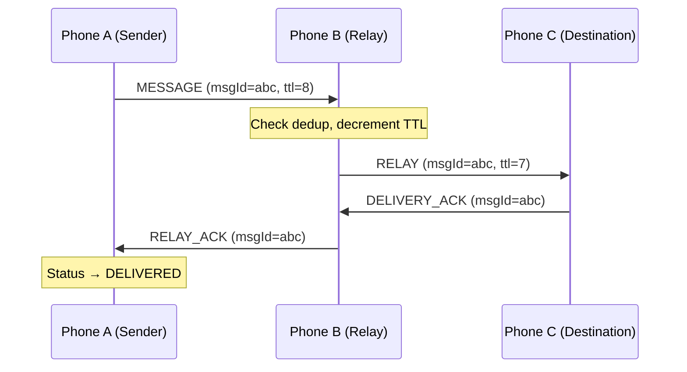

# LONE LINK — Message Lifecycle State Machine

## State Diagram



## State Definitions

| State | Description | UI Display |
|-------|-------------|------------|
| CREATED | Message created locally, not yet queued | ⏳ (clock) |
| QUEUED | In persistent queue, waiting for transport | ⏳ (clock) |
| ENCRYPTED | Payload encrypted for destination | 🔒 (lock) |
| SENDING | Actively being sent through a transport | ↑ (arrow up) |
| RELAYING | Handed off to a relay node | ⇄ (swap) |
| DELIVERED | Confirmed received at destination | ✓ (single check) |
| ACKNOWLEDGED | Read receipt from recipient | ✓✓ (double check) |
| FAILED | Delivery failed after attempts | ✗ (error) |
| EXPIRED | TTL or timestamp expired | ⏱ (timer off) |

## State Transitions

### CREATED → QUEUED
- **Trigger:** Message service receives the message
- **Action:** Save to database, add to pending queue
- **Guard:** Message text not empty, recipient valid

### QUEUED → ENCRYPTED
- **Trigger:** Queue processor picks up the message
- **Action:** Encrypt payload using recipient's public key (AES-256-GCM with X25519 key exchange)
- **Guard:** Recipient's public key available

### ENCRYPTED → SENDING
- **Trigger:** A transport is available to reach the destination (or next hop)
- **Action:** Create MessageEnvelope, send through transport
- **Guard:** Transport status is READY or CONNECTED

### SENDING → DELIVERED
- **Trigger:** Destination peer sends back a DELIVERY_ACK
- **Action:** Update message status, record delivery time and transport type
- **Guard:** ACK message ID matches, signature valid

### SENDING → RELAYING
- **Trigger:** Next-hop relay node accepted the packet
- **Action:** Record relay hop, wait for downstream ACK
- **Guard:** Relay node is a valid connected peer

### SENDING → FAILED
- **Trigger:** Transport error, timeout, peer disconnect
- **Action:** Increment retryCount
- **Guard:** None — any transport failure triggers this

### FAILED → QUEUED (Retry)
- **Trigger:** Retry scheduler runs
- **Action:** Re-enqueue with exponential backoff delay
- **Guard:** retryCount < maxRetries AND message not expired
- **Backoff:** delay = min(initialDelay × 2^retryCount, maxDelay)

### FAILED → EXPIRED
- **Trigger:** retryCount >= maxRetries OR message timestamp expired
- **Action:** Mark as expired, remove from queue
- **Guard:** One of the expiry conditions met

### QUEUED → EXPIRED
- **Trigger:** Queue processor detects expired message
- **Action:** Remove from queue, update status
- **Guard:** currentTime > message.expiry OR message.ttl exhausted

### DELIVERED → ACKNOWLEDGED
- **Trigger:** Recipient sends explicit READ ack
- **Action:** Update status and acknowledgedAt timestamp
- **Guard:** This is optional — depends on recipient app state

## Retry Behavior

```
Attempt 1: delay = 2s
Attempt 2: delay = 4s
Attempt 3: delay = 8s
Attempt 4: delay = 16s
Attempt 5: delay = 32s
Attempt 6: delay = 64s
Attempt 7: delay = 128s
Attempt 8: delay = 256s
Attempt 9: delay = 300s (capped)
Attempt 10: delay = 300s (capped) → then EXPIRED
```

## Multi-Hop ACK Flow


